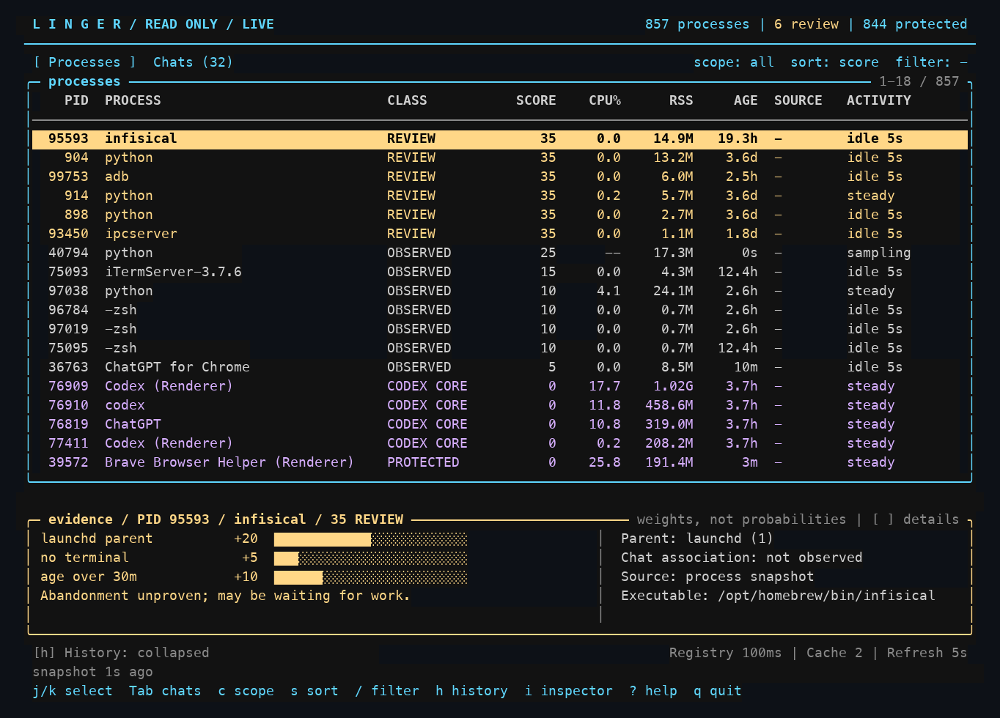

<p align="center">
  
  <br />
  <!-- repo-tagline:start -->
  <strong>🔎 Find what is lingering. Understand what must stay 👻</strong>
  <!-- repo-tagline:end -->
</p>

Linger helps macOS developers review suspicious background processes without
changing them. Its terminal interface puts review candidates first and explains
each classification. Codex-specific checks help distinguish review candidates
from helpers that may still hold a saved chat's REPL variables or browser state.



*Rendered capture of Linger running on macOS, with scoring evidence for the selected process.*

**Monitoring is read-only.** Linger has no kill, signal, pause, renice, cleanup,
or settings-changing operations, and no background service or network client.
It stores ownership and opt-in launch metadata privately; `--no-cache` disables
saved metadata in the monitor. Codex files remain read-only.

## Try it

Requires **Python 3.11 or newer with curses**. There are no third-party runtime
dependencies. To try it without installing, run from this repository's root:

```sh
python3 -m linger --demo --once
```

You'll see a `DEMO / SYNTHETIC` snapshot with process classifications, reasons,
and sample saved-chat activity. The demo works without macOS and does not inspect
your local processes or chats. For example, one candidate explains its uncertainty:

```text
   4901    50 REVIEW          117.2M    2.0h /demo/old-worker
        Parent is launchd; could be orphaned or a managed service.
        No CPU increase observed for 120s; this does not prove abandonment.
```

The demo's `LIKELY STALE` row illustrates a future detector. **The live version
cannot yet identify completed ephemeral Codex helpers.**

On **macOS**, open an interactive terminal and inspect your own processes:

```sh
python3 -m linger
```

To install an editable global command with [uv](https://docs.astral.sh/uv/), run
from the repository root:

```sh
uv tool install . -e
linger
```

The installed command follows changes in this checkout, so keep the checkout in
place. All command-line options also work with `linger`.

The full-width process table keeps the selected row's evidence below it. Use
`j` / `k` or the arrow keys to select, `i` to toggle the inspector, and `h` to
expand CPU/RSS history. Press `Tab` for saved-chat associations, `c` to cycle
scopes, `?` for help, and `q` to quit. The view refreshes every five seconds;
CPU usage needs two samples. History stays in memory for this run.

To track a command and its observed helpers from launch:

```sh
linger run --temporary -- python3 your_script.py
```

Use `--temporary` only when those helpers are intended to end with the command.
Omit it to preserve persistent state. Run `linger` in another terminal to inspect
the evidence. Successfully exited temporary commands can flag observed leftovers
for Review; nothing is stopped automatically. [Tracking details](docs/usage.md#optional-launch-tracking).

## Read the result

- **Recognize managed services.** Verified launchd jobs and their descendants
  stay protected, with service labels and available restart-policy information.
- **Prioritize inspection.** `REVIEW` flags evidence worth checking, such as a
  missing parent or observed CPU inactivity. Scores are rule weights, not
  probabilities or permission to terminate anything.
- **Recognize possible tool state.** Codex classifications preserve recognized
  infrastructure, saved-chat associations, and unresolved helpers. A completed
  chat turn does not mean its REPL or browser state can be discarded.
- **Follow observed associations.** While the terminal interface runs, Linger
  watches Codex's existing execution registry and remembers validated process/chat
  associations across Linger restarts, rechecking PID and native birth time before
  using them. It can retain multiple
  chat associations for one process; exclusive ownership is not established.

Old age, low CPU, absent registry records, or absence from the saved-chat index
do not prove abandonment. Starting Linger after an execution finishes cannot
recover its vanished registry record unless Linger previously observed and cached
the association. One-shot modes load validated history and sample once. Summed RSS includes shared memory and is not an
estimate of reclaimable RAM.

## Go deeper

- [Usage and interpretation](docs/usage.md): all controls, process and chat
  labels, Codex-only scope, JSON output, alternate Codex homes, and limitations.
  JSON can include private executable paths and chat IDs; inspect it before sharing.
- [Evidence and implementation](docs/evidence.md): data sources, scoring rules,
  registry validation, and module boundaries.
- [Ownership investigation](docs/ownership.md) and
  [read-only signal audit](docs/read-only-signals.md): verified observations and
  the remaining gaps in ephemeral-helper detection.

CI runs the offline test suite and synthetic demo on macOS with Python 3.11 and
3.14 for pushes to `main` and pull requests. No third-party dependencies are
installed. The demo does not inspect real processes or chats.

To run the test suite from the repository root:

```sh
python3 -m unittest discover -s tests -v
```

## License

[MIT License](LICENSE).
